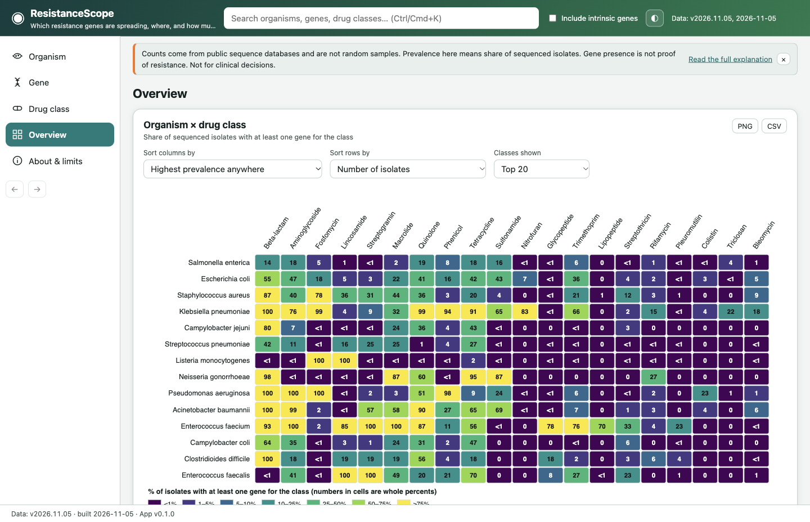
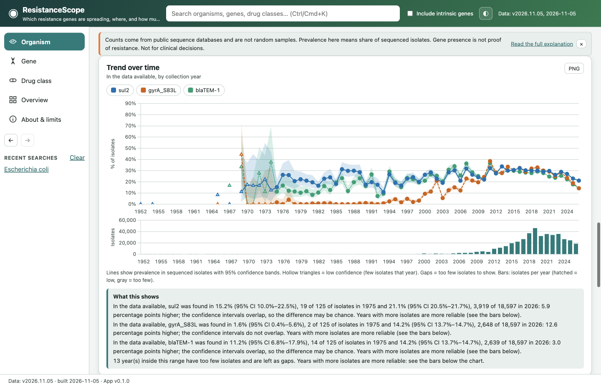
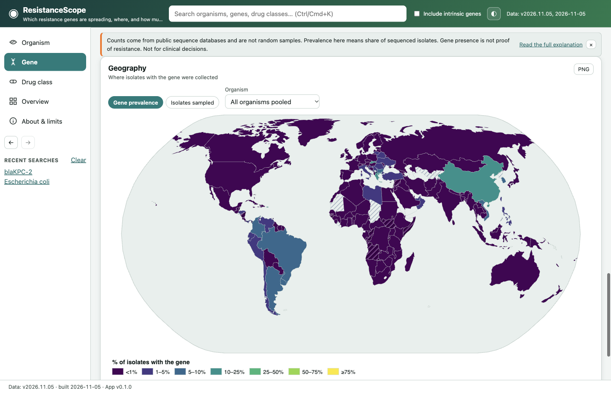
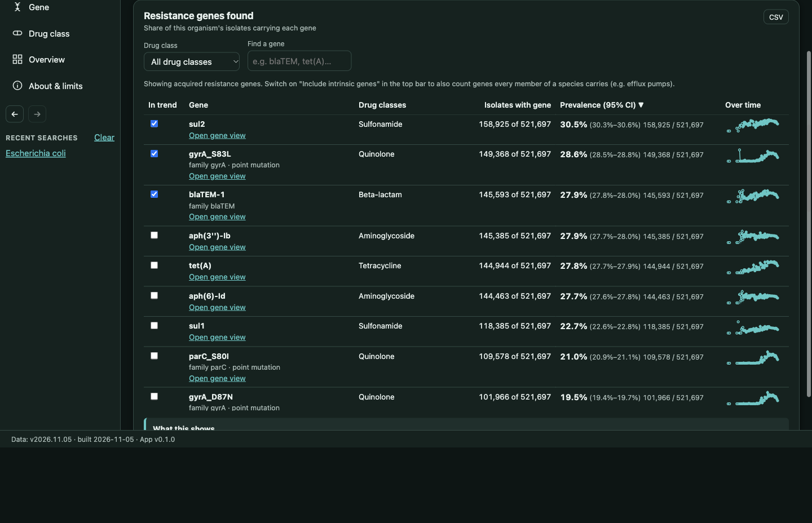
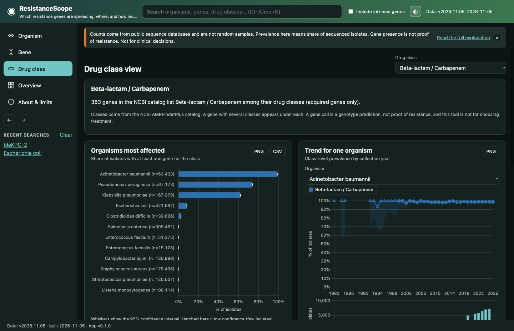

# ResistanceScope

**Which antibiotic-resistance genes are spreading, in which bacteria, where, and how much should you trust the picture?**

ResistanceScope is an offline desktop app (Windows, macOS, Linux) for exploring antibiotic-resistance genes found in
publicly available bacterial genome sequences. A separate Python pipeline turns public NCBI files into a few megabytes of
validated JSON that ships *inside* the app, so the app is fast, fully offline, reproducible, and never touches the network.

> **Educational use only. Not for clinical decisions.** Numbers are shares of *sequenced isolates in public databases*
> (not random samples, not true prevalence). A gene call is a genotype prediction, not proof that a drug fails.



<table>
  <tr>
    <td></td>
    <td></td>
  </tr>
  <tr>
    <td></td>
    <td></td>
  </tr>
</table>

More pictures (light and dark, every main view) are in [`docs/screenshots/`](docs/screenshots/).

## What you can do

- **Organism view:** pick a bacterium (for example *E. coli*, *S. aureus*, *K. pneumoniae*) and see its resistance genes with
  confidence intervals, drug-class shares, trends over time with isolates per year underneath, a world map, and where the
  isolates came from (clinical, food, environmental, animal).
- **Gene view:** what a gene is (family, drug classes, RefSeq link), which organisms carry it, its pooled trend and map, related genes.
- **Drug class view:** which genes confer resistance to a class, which organisms are most affected, and a class-level trend.
- **Overview:** an organism × drug-class heatmap and a compare mode for two organisms.
- Global search (typos and aliases tolerated), back/forward, recent searches (stored only on your device, with a Clear button),
  CSV and PNG export, dark mode, and a toggle that includes or excludes intrinsic genes such as efflux pumps.

The shipped data (version `2026.11.05`): **14 organisms, 2,790 genes, 114 drug classes and subclasses, 2,471,459 isolates**,
in 3.05 MB.

## Download

Installers are attached to each [GitHub Release](https://github.com/reeper316099/ResistanceScope/releases):

| System | File |
|---|---|
| Windows | `ResistanceScope-<version>-win-x64-setup.exe` (installer) or `…-portable.exe` |
| macOS (Apple Silicon and Intel) | `ResistanceScope-<version>-mac-universal.dmg` |
| Linux | `ResistanceScope-<version>-linux-x86_64.AppImage` or `…-linux-amd64.deb` |

Each release also has a `SHA256SUMS` file. To check a download: `shasum -a 256 <file>` (macOS), `sha256sum <file>`
(Linux) or `Get-FileHash <file>` (Windows PowerShell), and compare with the line in `SHA256SUMS`.

### Unsigned apps: what you will see and how to open them

The installers are **not code-signed or notarized** (that needs paid developer certificates, which this free project does
not have). Your operating system will therefore warn you. That is expected; it does not mean anything was tampered with,
but you should only download from the official Releases page and check the checksum.

**Windows (SmartScreen: "Windows protected your PC / unknown publisher")**
1. Run the installer. When the blue SmartScreen box appears, click **More info**.
2. Click **Run anyway**.

**macOS (Gatekeeper: "cannot be opened because the developer cannot be verified")**
1. Open the `.dmg` and drag ResistanceScope to **Applications**.
2. In Applications, **right-click (or Control-click) ResistanceScope, choose Open**, then click **Open** in the dialog.
3. If macOS still refuses (newer versions): open **System Settings, Privacy & Security**, scroll to the message about
   ResistanceScope and click **Open Anyway**.
4. Last resort, in Terminal: `xattr -dr com.apple.quarantine /Applications/ResistanceScope.app`

**Linux**
- AppImage: `chmod +x ResistanceScope-*.AppImage`, then run it.
- Debian/Ubuntu: `sudo apt install ./ResistanceScope-*-linux-amd64.deb`.
- On recent Ubuntu versions Chromium-based apps can fail to start with a sandbox message. The usual workarounds are to allow
  unprivileged user namespaces (`sudo sysctl -w kernel.apparmor_restrict_unprivileged_userns=0`) or to start the app with
  `--no-sandbox` (which disables an important protection, so only do it for this app).
  *This Linux guidance comes from how Electron behaves on Ubuntu runners; it was not tested on a desktop machine.*

## How it works

```
 public sources                    pipeline (Python, build time)                 app (Electron + TypeScript, run time)
┌────────────────────┐   download  ┌────────────────────────────────────┐        ┌───────────────────────────────────┐
│ NCBI Pathogen      │ ──────────▶ │ parse, clean (dates, countries,    │ writes │ data/ folder shipped in the app   │
│ Detection (per-    │  ~2.3 GB    │ sources), map gene names, drop     │ ─────▶ │  manifest.json  index.json        │
│ isolate AMR genes) │  raw files  │ duplicates, AGGREGATE to counts    │  3 MB  │  organisms/<taxonId>.json         │
│ NCBI AMRFinderPlus │  (git-      │ validate.py: fail on any bad count │        └───────────────┬───────────────────┘
│ gene catalog       │  ignored)   └────────────────────────────────────┘                        │ app:// (no network)
└────────────────────┘                                                          zod validates every file on load
                                                                                                 ▼
                                                                      queries.ts -> Estimate(k, n, Wilson CI, flag)
                                                                                                 ▼
                                                                          charts, map, heatmap, tables, CSV/PNG export
```

- The shipped JSON holds **only counts** (no isolate records, no sample accessions).
- The Python `validate.py` and the app's zod schemas enforce the same rules, and a test loads the real `data/` folder
  through the schemas in CI, so the two languages cannot silently drift apart.
- A monthly GitHub Action rebuilds the data and opens a pull request for review; it never pushes to `main`.

## Data sources

All data was accessed on 2026-11-04/05. Full licence wording, citations and how attribution is met are in
[`DATA-SOURCES.md`](DATA-SOURCES.md); library and map licences are in [`THIRD-PARTY-NOTICES.md`](THIRD-PARTY-NOTICES.md).

| Source | Used for | Terms (summary) |
|---|---|---|
| [NCBI Pathogen Detection](https://www.ncbi.nlm.nih.gov/pathogens/) per-isolate AMR metadata | isolate counts by organism, year, country, source; gene calls | US Government public-domain policy; acknowledge NLM |
| [NCBI AMRFinderPlus Reference Gene Catalog](https://github.com/ncbi/amr) (DB 2026-10-29.1) | gene symbols, families, drug classes, product names | public-domain notice; please cite Feldgarden et al. |
| [Natural Earth](https://www.naturalearthdata.com/) via `world-atlas` | map shapes | public domain (ISC package licence) |
| [Unicode CLDR](https://cldr.unicode.org/) | English country names | Unicode License v3 (notice reproduced) |
| CARD (McMaster) | **not used** | redistribution is not allowed, so nothing from CARD ships |

Citations: Feldgarden M, et al. *Validating the AMRFinder tool and resistance gene database by using antimicrobial
resistance genotype-phenotype correlations in a collection of isolates.* Antimicrob Agents Chemother 2019;63(11):e00483-19.
Feldgarden M, et al. *AMRFinderPlus and the Reference Gene Catalog facilitate examination of the genomic links among
antimicrobial resistance, stress response, and virulence.* Sci Rep 2021;11:12728, doi:10.1038/s41598-021-91456-0.

## The statistics, and why you should be careful

- **Prevalence** here means *k ÷ n*: the share of sequenced isolates (n) of an organism that carry a gene (k). Every
  percentage in the app is shown with its n.
- **95% confidence interval (Wilson score).** A range showing how uncertain a percentage is, especially with small samples.
  Wilson behaves well for small n and for values near 0% or 100%, unlike the textbook "plus or minus" formula. It reflects
  random sampling noise only; it cannot fix a biased sample.
- **Thresholds** (stored in `manifest.json`): fewer than **5** isolates → hidden (no number is shown at all; the `Estimate`
  type has no percentage field in that case); fewer than **30** → shown but marked "low confidence" (hollow markers,
  hatching, a text badge). Trends refuse to compare years unless both rest on enough isolates; thin years are drawn as gaps, never zeros.
- **Sampling bias is real.** Public genome databases over-represent outbreak investigations and a few countries. In the
  shipped data, for example, 74% of the *Campylobacter coli* isolates with a known country come from the USA alone
  (33,050 of 44,541), and 67% for *Salmonella enterica*. So the maps mostly show where sequencing happens.
- **Genotype is not phenotype.** A resistance gene suggests, but does not prove, a resistant bacterium. The app is not for
  choosing treatment.
- **What the data cannot do:** counts are stored by year, by country and by source *separately* (no cross-tables, to stay
  small), so the source filter cannot be combined with trends or maps. A gene missing from an organism's file means "seen
  in fewer than 5 isolates", never 0%. Many organisms have a few isolates dated 1950, which may be placeholder dates in the
  source data; thin years are flagged or left as gaps.

## Run from source

Requires Node 22 and, for the data pipeline, Python 3.11.

```bash
npm ci
npm run dev          # window opens in the foreground; use `npm run dev:bg` to open it without taking focus
npm run typecheck && npm run lint && npm test
npm run test:e2e     # builds, then drives the real Electron app
npm run dist:dir     # unpacked app for your OS in release/ (then: npm run test:packaged)
npm run dist         # installers for your OS
npm run screenshots  # regenerates docs/screenshots
```

Rebuild the data (downloads about 2.3 GB from NCBI; see [`pipeline/README.md`](pipeline/README.md)):

```bash
cd pipeline && python3 -m venv .venv && .venv/bin/pip install -r requirements-dev.txt && cd ..
npm run data:rebuild
```

Building installers inside an iCloud-synced folder (for example the macOS Desktop) can fail at the code-signing step because
iCloud adds file attributes that `codesign` rejects. Build from a normal folder, or write the output elsewhere:
`npx electron-builder --mac -c.directories.output=/tmp/rs-release`.

## What was and was not tested (honest status)

Details, numbers and the data-quality table are in [`docs/TEST-REPORT.md`](docs/TEST-REPORT.md).

| What | Status |
|---|---|
| Dev build on macOS: typecheck, lint, 273 unit tests (incl. real-data contract), 48 Electron end-to-end tests | **Ran and passed** |
| Pipeline: 92 pytest tests, full run on the real data (about 97 s to aggregate), independent spot-check (12 of 12 match) | **Ran and passed** |
| macOS universal `.dmg` built here, mounted, packaged app launched and passed 4 packaged-app tests (arm64 slice) | **Ran and passed** |
| Electron fuses effective in the packaged macOS binary (cannot run as plain Node, ignores `--inspect`) | **Ran and passed** |
| macOS Intel (x86_64) slice of the universal app | **UNTESTED LOCALLY** (built, never launched) |
| Windows installer and portable `.exe` | Cross-built here, **never launched. UNTESTED LOCALLY, verified only by CI** |
| Linux AppImage and `.deb` | Cross-built here, **never launched. UNTESTED LOCALLY, verified only by CI** |
| `ci.yml` on GitHub (first run, 2026-11-05): `pipeline` job and the packaged Linux smoke test (`package-smoke`) | **Ran on GitHub and passed** |
| `ci.yml` job `app`: 47 of 48 Electron e2e tests passed on Linux; the restart-persistence test hung (see CHANGELOG) | **Partly passing; fix pushed, awaiting a green re-run** |
| `release.yml` on GitHub: builds and uploads installers for all three systems | **Ran and succeeded (reported by the author); installers not yet launched on Windows or Linux** |
| `refresh-data.yml` | Checked with `actionlint`; **never run. UNTESTED LOCALLY, verified only by CI** |
| Time and disk used by the monthly refresh on a GitHub runner | **Not measured** |
| Screen reader use; full keyboard-only use of the heatmap (a table alternative exists) | **Not tested** |

This table is updated when real runs pass.

## Automation (GitHub Actions)

- **CI** (`ci.yml`): format, types, lint, unit tests (including the real-data contract test), Electron end-to-end tests under a
  virtual display, pipeline lint and tests, validation of the committed data, and a packaged Linux smoke test.
- **Release** (`release.yml`): pushing a tag like `v0.1.0` builds Windows, macOS and Linux installers, attaches them to the
  release and adds `SHA256SUMS`. Only official `actions/*` actions and the preinstalled GitHub CLI are used.
- **Refresh data** (`refresh-data.yml`): monthly, rebuilds `data/` from NCBI, validates it, and opens a **pull request** with a
  summary of what changed. It never pushes to `main`. Pull requests opened with the default token do not start CI by
  themselves; close and reopen the pull request to run it.
- There is deliberately no web version and no GitHub Pages workflow.

Step-by-step release instructions: [`docs/RELEASING.md`](docs/RELEASING.md).

## Security notes

Context isolation on, Node integration off, renderer sandbox on, a strict Content-Security-Policy (no inline script, no
`eval`; tested with a probe that runs as the page's own script), all non-`app://` requests blocked, navigation and new
windows blocked, permissions denied, a three-function preload (`saveFile`, `openExternal`, `getAppInfo`) whose arguments are
re-validated in the main process, an `app://` protocol that rejects path traversal, and Electron fuses that switch off
`ELECTRON_RUN_AS_NODE`, `NODE_OPTIONS` and `--inspect` in the packaged app. The app makes no network requests; the only
outbound action is opening an allowlisted `https` link in your system browser when you click it.

## Project layout

```
electron/     main process, app:// protocol, menu, IPC, security (preload.ts = the 3-function bridge)
src/core/     stats (Wilson), queries, search, export, data loader, colours, narrative sentences (pure, unit-tested)
src/ui/       views (organism, gene, drug class, overview, about), charts (Chart.js, SVG map and heatmap), search box
src/shared/   zod schemas and shared types (the one source of truth for data and IPC shapes)
pipeline/     download -> parse -> aggregate -> validate (Python), spot_check.py, tests with hand-checked fixtures
data/         the shipped aggregated JSON + manifest (checksums)
tests/        unit (Vitest), e2e (Playwright driving Electron), fixtures
docs/         screenshots, test report, release steps
.github/      CI, release and data-refresh workflows
```

## Stretch list, ranked by impact for the effort

| # | Idea | Impact | Effort | Why this rank |
|---|---|---|---|---|
| 1 | **Surveillance gaps view**: show where data is thin (organism × country/year cells with few isolates) | High: supports the app's honesty message directly | Low: the counts are already in the shards | best value for the work |
| 2 | **Code signing, notarization and auto-update** | High: removes the OS warnings and makes updates safe | Medium-high: paid certificates (Apple Developer, Windows) and release plumbing | biggest friction for real users, but costs money |
| 3 | **Gene co-occurrence network** (Cytoscape): which genes travel together | Medium-high | Medium: needs a new pipeline output (pair counts) and a graph view | impressive and educational |
| 4 | **Lab phenotype data (BV-BRC)** next to genotype calls | High scientifically (tests "gene ≠ resistance") | High: new source, licence check, name mapping, new statistics | strongest science, most work |
| 5 | **Plasmid vs chromosome breakdown** | Medium | High: the aggregated metadata does not say where a gene sits; needs a different NCBI output | least certain to be feasible |

## Licence

Code: MIT, see [`LICENSE`](LICENSE). Data: aggregates derived from public NCBI data; see [`DATA-SOURCES.md`](DATA-SOURCES.md).
Third-party licences: [`THIRD-PARTY-NOTICES.md`](THIRD-PARTY-NOTICES.md). Map shapes: Made with Natural Earth.

## What I learned

<!-- TODO (author): write this section yourself in your own words before sharing the project.
     Suggested prompts: what surprised you about public AMR data, what was hardest about keeping the statistics honest,
     what you would build next, and which part you can now explain to someone else. -->

*(This section is intentionally left for the author to write.)*
